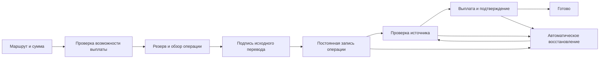

# План ремонта и рефакторинга Singularity

Основание: [ревью 10 октября 2026](./project-review-2026-10-10.md). IDs B/U/T ниже ссылаются на его доказательства. Приоритет — человек сохраняет доступ к деньгам, видит реальный результат и может продолжить действие после сбоя. Архитектурные изменения обслуживают этот результат.

## Выполненная первая итерация · 10 октября 2026

Изменения подготовлены в рабочей копии; production не обновлялся и реальные
переводы для проверки не отправлялись. Существующие пользовательские изменения
сохранены.

- **Кошелёк:** отдельный CYBER ↔ WCYBER в «Ещё», действие в сети и анврап в
  карточке канонического wrapped-token. `/wallet?wrap=wrap|unwrap` ждёт открытия
  vault. Используется существующий signer и контракт обёртки, 1:1 и комиссия
  только за газ; чужой токен с названием WCYBER не получает действие анврапа.
- **B01/B02:** native source proof проверяет успешную транзакцию, точные
  contract/mint/program, sender, recipient и nonce. EVM payout берётся из net
  события, Solana mint — из фактического debit/credit; POST не увеличивает
  выплату. Smart-wallet и batch receipts сохранены. Неизвестный RPC оставляет
  обязательство pending без выплаты. Configured override адреса bridge имеет
  приоритет, default совпадает с deployed registry и frontend.
- **B04/B05:** pool lock удерживается до выхода из payout-секции; timeout
  оставляет awaiting_liquidity. Wallet и wizard используют общий reserve helper:
  отказ, malformed/expired claim и ошибка сети не достигают signer. Wallet
  фиксирует сумму, recipient и источник до await, передаёт claim при submit.
- **Часть B07:** native relay пишет broadcast hash сразу после отправки и до
  ожидания receipt; первый mint hash сохраняется как защита повторной выплаты
  при прерванной conversion. Это ещё не автоматический reconcile.
- **T04/U02:** bridge_completed требует completed и destination hash; source
  broadcast называется transaction_submitted. Push переводит существующее окно
  на полный адрес, включая нужный section и fragment.
- **Отказ от Ritual:** публичные страницы, меню, token links, landing, bot и
  документация направляют во встроенный `/swap`. Иконки токенов обслуживаются
  локально. Legacy host получает redirect; старый frontend и контракты
  сохраняются для совместимости существующих pools.
- **Explorer:** прозрачный PNG перегенерирован без свечения; HTTP/HTTPS aliases
  и read-only branding mount подготовлены. Для установки нового mount нужна
  пересборка конфигурации контейнера proxy, одного nginx reload недостаточно.
- **T02/T03:** frontend types/tests и native relay tests включены в CI;
  contract job входит в production gate. Debug APK имеет отдельное имя и
  artifact, не входит в public release-* collection.

Проверено: полный PHP-прогон 1409 tests / 6863 assertions; после финального
изменения default bridge повторно 249 bridge tests / 958 assertions и 7 native
relay tests. Frontend 424 tests, TypeScript и production build прошли; extension
43, mobile 12, Telegram 153 (1 skip), docs build — успешно. Браузерный
прогон production bundle с изолированным временным vault и mocked RPC:
wrap/unwrap → quote → review на ru/390 px, en/1440 px, zh/360 px —
без JS errors и horizontal overflow; реальные подписи не выполнялись.
Также исправлена нечитаемая подпись HoldButton в светлой теме: контраст
17,1:1 до начала удержания; раннее отпускание Enter прекращает progress
без broadcast во всех шести сценариях. Nginx templates
проверены локальным `nginx -t` с тестовыми сертификатами, localhost upstreams и
непривилегированными портами. Изолированный nginx отдал HTTP/HTTPS light/dark
logo с совпадающим SHA-256 и Cache-Control; legacy host вернул 301 с сохранением
query. Production compose/env этим не проверены.

### Вторая итерация · 20 октября 2026

Production не обновлялся, реальные переводы не отправлялись.

- **B03 закрыт в коде.** Получатель выплаты привязан к депозиту самим
  отправителем: подготовленный адрес (Yenten/Monero/BTC/LTC), событие
  CyberBridge (CYBER.sol → Solana), комментарий TON
  `cyberia-bridge:<получатель>` или подпись отправляющего ключа
  (`App\Support\BridgeIntent`, EIP-191/ed25519, отдельная формулировка, не
  login) над reservation reference до перевода либо над source hash после.
  Заявка без доказательства записывается как `awaiting_recipient`: не
  выплачивается, не занимает capacity, перехватывается первой корректно
  подписанной заявкой того же отправителя. Строки до миграции тоже
  удерживаются; вручную их освобождает `bridge:attest-recipient`.
- **B07:** `bridge:reconcile` каждые 5 минут продвигает `paying_out`,
  `burn_pending`, `awaiting_liquidity`, зависшие `pending` и брошенные
  `processing`; строка с payout hash только сверяется с цепью. Нативные ветки
  больше не объявляют `completed` по одному наличию hash. `bridge:relay` для
  `paying_out` проверяет hash вместо отказа.
- **Часть B06:** кошелёк записывает отправленный депозит в локальный журнал
  до регистрации и при следующем открытии повторно регистрирует
  незарегистрированные (идемпотентно, без подписи). `dispatchSync` в submit
  не заменён: сначала нужно проверить worker на production. Мастер `/bridge`
  журнал пока не использует.

### Следующие небольшие изменения

1. ~~**B03:** привязать direct/Solana deposit к неизменяемому, подписанному bridge
   intent.~~ Сделано 20 октября, см. выше; осталась проверка на staging.
2. **B06/B07:** идемпотентный submit, локальный журнал незавершённых переводов и
   reconcile существующих hashes. Worker configuration проверить перед заменой
   dispatchSync. Конвертация после mint и burn_pending получают отдельные
   подтверждения, наличие hash само по себе не означает completed.
3. **UX:** Browser/native Back с сохранением формы, согласованные состояния
   операции и destination hash, затем offline shell и первый funding path.
4. **Приёмка и выпуск:** проверить текущие production obligations/configuration
   read-only; staging сценарии с настоящими wallets; отдельно установить proxy
   branding mount и redirect, затем выпускать финансовые изменения.

**Что значит восстановление перевода.** Если депозит уже отправлен, а вкладка
закрылась или ответ сервера потерялся, приложение должно найти ту же операцию
по её сохранённым доказательствам, показать статус и продолжить оставшиеся
шаги. Повторно отправлять исходные деньги не требуется. В этой итерации
укреплено сохранение server-side payout hash; полный пользовательский сценарий
после reload ещё входит в B06/B07.

## Порядок работ

| Этап | Результат | Зависимости | Оценка работы |
| --- | --- | --- | --- |
| 0. Зафиксировать production-состояние и ограничить дефектные пути | Известны deployed версии, obligations и границы инцидента; новые непроверенные выплаты недоступны | Операторский read-only доступ; B01–B03 | 0,5–1 день |
| 1. Отремонтировать мост | Source proof, recipient binding, reserve-first, корректный lock, идемпотентный submit и автоматический reconcile | Этап 0; B01–B07 | 8–13 дней |
| 2. Исправить основной UX | Back/deep links/push, первый funding path, локализация, ясные статусы; измеримый прототип навигации | Bridge UX после этапа 1; U01–U08, T04 | 6–9 дней |
| 3. Сделать клиент и релизы воспроизводимыми | Gates поддерживаемого Laravel-клиента, безопасный Android release; реальные extension/shell acceptance | T01–T03; этап 1 для финансового E2E | 6–10 дней |
| 4. Разделить ответственность и укрепить эксплуатацию | Local wallet shell, небольшие modules, ops fixtures, проверки вторичных компонентов | Закреплённое поведение этапов 1–3; U03, T05–T06 | 7–11 дней |

Итого ориентир: 28–44 инженерных рабочих дня. Это оценка объёма, не календарное обещание; ожидание партнёрских аккаунтов, signing/store approval, production-доступа и контрактной миграции сюда не входит. UX-дизайн и настройка CI могут идти рядом с ремонтом моста; переключение финансовых путей — после его приёмки. При одном исполнителе это примерно 6–9 рабочих недель с резервом на проверки.

## Этап 0: установить, что действительно происходит на production

Ответственный: оператор + backend/chain инженер.

1. Снять read-only инвентаризацию: deployed commit, migrations, worker count/connection/timeout/retry_after, scheduler last run, operational route flags, состояния существующих obligations, destination liquidity/fee floors. Использовать существующую console/monitoring, не добавлять probe с побочными действиями.
2. Для B01–B03 оператору закрыть создание новых переводов через затронутые пути до ремонта; уже поступившие депозиты сохранить и сверить отдельно. Закрытие UI не заменяет серверный gate; trusted payouts нельзя выводить из одного `source_verified_at`, который выставлялся дефектным обработчиком.
3. Зафиксировать migration/recovery список: заявка, проверенное source event, подтверждённая сумма, разрешённый recipient, payout hash/receipt, незавершённый burn. Секреты и seed-фразы туда не включать.

Выход: каждая текущая заявка классифицирована по доказательствам; есть перечень разрешённых действий, а непроверенные source claims не запускают payout. Эти действия предложены планом, при ревью они не выполнялись.

## Этап 1: ремонт моста небольшими PR

| PR | Изменение | Приёмка |
| --- | --- | --- |
| 1. Native source proof | B01/B02: отдельные verified receipt/event результаты; raw amount, decimals, mint/contract, recipient, nonce и finality | Fabricated hash, wrong mint/destination, failed tx, amount inflation, wrong nonce/recipient дают ноль payout/mint; комиссии применяются один раз |
| 2. Deposit intent authorization | B03: неизменяемый intent с bridge-specific wallet proof; для неподписываемых источников отдельный prepared deposit address/memo | Чужой публичный hash не назначает payout; другой action/domain/recipient не проходит; replay не расходует один event второй раз |
| 3. Lock и reserve до signer | B04/B05: вся секция проверки/spend под lock; timeout recoverable; wallet и wizard используют один reserve-first orchestration | Два workers не проходят lock одновременно; unknown/zero reserve не открывает подпись; equality capacity допустимо; TTL охватывает normal critical section |
| 4. Submit и recovery | B06/B07: durable request + job после commit, idempotent response/lookup, local pending journal, reconcile schedule | Lost response, reload, worker restart и RPC timeout продолжают один перевод; payout hash запрещает второй send; burn выполняется отдельно |
| 5. Status presentation | Единый mapping domain states → wallet/wizard/console copy, age, destination hash, recovery action | Пользователь всегда понимает, отправлен ли источник, выплачен ли destination и кто должен действовать дальше |

Не менять арифметику на floats. Сохранить четыре состояния capacity, deliverable inventory с gas/rent floor, долговечный broadcast hash и порядок payout → durable hash → confirm → burn для применимых direct-путей. У native `redeemCyberSol` burn уже находится в user transaction: это ограничение текущего контракта, а не обещание нового server flow. Контрактный escrow или signed reservation проектировать отдельным последующим изменением с миграцией supply.

Минимальное разделение backend после закрепления tests: source verification, admission/inventory, destination delivery и reconciliation. Использовать существующие services и helpers; `BridgeService` сначала делегирует им, затем сокращается. Каждый PR сохраняет traceability старых записей; migration changes — additive и forward-compatible.

Рекомендуемая схема опыта пользователя:

Локальную запись intent нужно создать до broadcast; server obligation — до запуска relayer. Ветка восстановления читает состояние и существующие hashes: диаграмма не разрешает повторную отправку источника или destination.

## Этап 2: UX, который можно проверить

Ответственные: frontend инженер + продуктовый дизайнер; доступность провайдера — оператор/владелец продукта.

**Навигация.** U01/U02: извлечь один navigation adapter с serializable screen state и origin stack. В URL сохранять screen/network/asset, где они публичны; финансовые intents и секреты в URL не помещать. Browser Back, Telegram Back и native Back используют одну семантику. Overlay закрывается первым; draft остаётся, пока человек явно его не отменил. Push переходит к полному destination; raw `replaceState({})` не должен уничтожать состояние Inertia.

**Первое пополнение.** U04: первый портфель содержит понятный следующий шаг «Получить средства», выбор сети и способа. Есть работающий address/QR path. Покупка с карты появляется как доступный путь только при настроенном провайдере; остальные причины объясняются до ввода суммы. Покупка на Base/Solana и последующий перевод в Cyberia — две явно названные операции. Переключение/добавление сети сохраняет введённые данные и выбранный delivery asset.

**Сохранение доступа.** Сохранить мгновенное auto-create. Превратить нынешнее backup-предупреждение в краткое действие с объяснением локального хранения и проверяемым завершением backup. Для Telegram — рядом указать риск очистки WebView storage. Пароль можно добавить позже; интерфейс должен честно говорить, когда vault ещё не защищён. Keys продолжают жить только на устройстве.

**Первый экран и advanced features.** U07: прототипировать portfolio с балансом, тремя основными действиями, активными переводами и 3–5 наиболее нужными/избранными shortcuts. Полный каталог остаётся в «Ещё». Сначала проверить задачи, затем менять текущие 15 shortcuts и нижнюю навигацию. Не скрывать существующие функции без предсказуемого пути и миграции избранного.

**Язык и ошибки.** U05/U08: bridge/swap/header и route reasons переводить через общий browser locale. Server сообщает стабильный reason code, frontend — сообщение и действие. Error states различают retryable network failure, неподдерживаемую возможность, отсутствие конфигурации и подтверждённый отказ. Quote, chart и balance имеют независимые loading/error/stale состояния. Шаг review показывает минимум получения, полную комиссию, сеть и необратимость до hold.

**Обмен и врап.** Ritual выводится из пользовательских путей. Врап открывается
отдельным действием, показывает 1:1 и газ, не предлагает цену рынка или
проскальзывание. Обмен и liquidity продолжают использовать существующие
on-chain pools через поддерживаемый Laravel UI.

Приёмка этого этапа — browser journeys на 360, 390, 768 и 1440 px, light/dark, en/ru/zh для поверхностей с этими словарями. Проверять focus, keyboard, readable error announcements, reduced-motion и touch targets. Цель для главных мобильных действий — не менее 44×44 px; это продуктовый ориентир. Минимум WCAG 2.2 — 24×24 с оговорёнными исключениями, поэтому не объявлять любой меньший 44 px target нарушением: [W3C](https://www.w3.org/WAI/WCAG22/Understanding/target-size-minimum).

## Этап 3: инструменты, CI и установка

1. T01: CRA/Vite миграцию retired Ritual отменить. Его неработающие tests/types
   остаются характеристикой архивного компонента; новые пользовательские пути
   ведут в Laravel swap/wallet. Не переносить contracts или liquidity при
   удалении фронтенд-ссылок.
2. T02: Laravel frontend types/tests/build, extension/shell rules и native
   relay tests должны входить в соответствующие gates. Затем добавить
   path-filtered LainOS/Telegram/DNS suites и critical browser journeys для
   wallet/bridge/swap/sw. Полный frontend lint пока имеет ранее выявленные
   ошибки: исправлять scoped, не скрывать новые и не маскировать старые.
3. T03: разделить debug и release APK. Release требует постоянную signing identity, отсутствующий debug flag и проверяемый artifact manifest; download получает только approved builds. Проверить update старого APK без потери WebView storage и восстановление из backup. Не публиковать debug wallet под общим именем.
4. Extension: проверить настоящие Chromium/Firefox origins grants, restart/service-worker wakeup, approval window, decline/cancel и сеть за proxy. Неподписанный Firefox build честно temporary; для постоянной установки завершить signing/distribution и согласовать download page с настоящим artifact. Учесть уже идущие изменения в рабочей копии.
5. Сборки поддерживаемых клиентов выполнять в предназначенном окружении и проверять manifest/assets. Retired Ritual не является release artifact. Публикация и production rollout — отдельный финальный шаг после просмотра конкретного результата.

## Этап 4: структура и вторичные компоненты

**Локальный wallet shell, U03.** Отдельный публичный bootstrap для `/wallet`, который не требует authenticated Inertia HTML для открытия существующего vault. Реестры и capabilities — совместимые с online версией. Версионировать cache; authenticated HTML/API, seed/private keys и recovery phrase туда не попадают. Offline balances имеют явный age/unavailable; signing/broadcast зависит от доступности сети и актуального fee/nonce. Проверить PWA reload, desktop start и mobile airplane mode. Этот пункт имеет больший объём, чем косметический offline banner.

**Vue modules.** `Wallet.vue` разделить на navigation, frame, bootstrap и выбранный screen. Signing/balance adapters оставить в `useMultiWallet`/chain modules с явными boundary types. Для редких advanced screens оценить async imports по baseline bundle, а не только по длине файла. `WalletSwap`/`Swap.vue` используют проверенные quote, review и settlement helpers; финансовое поведение переносится после negative tests. Не создавать второй chain registry или вторую систему локализации.

**Ops.** T05/T06: решить судьбу Lisp helper, оформить SDK manifests/test commands, добавить безопасные compose fixtures вместо production absolute env. Проверить реальные service states существующими probes: chain head age, explorer lag, Monero sync, UDP/TCP DNS, IRC TLS, IPFS read/pin path в тестовом окружении. Второй node запускать по отдельному runbook, без изменения validator set. Ненужный компонент сначала инвентаризировать и решить с владельцем, не удалять автоматически.

**Console.** В отдельной операторской сессии проверить heartbeat failures, quiet/unmeasured states, drafts, read markers, composer, mobile filters и copy whole values. Сохранить один cached build banner/rail/queue и polling only while visible. Рефакторинг presentation не меняет admin gate, отправку сообщений, ingest permissions и правила аналитики.

**Игры/сайт.** Anchor — local integration authority/lock/release/replay tests; Wired — connect→mint→gate→NPC; NO CARRIER — save/reload, язык, terminal keyboard и необязательное NFT sealing; Jekyll/landing/docs — broken links, mobile headings/contrast и navigation consistency; Minecraft/Linux — отдельные build/runtime acceptance в подходящем окружении. Существующий успешный smoke не превращать в обещание готового production продукта.

## Как оценивать улучшение UX

Сначала baseline, затем одинаковые задания на старом и новом интерфейсе. Для formative проверки — 5–8 человек, включая новичков и текущих пользователей; результаты малой группы не объявлять статистически доказанным ростом конверсии.

| Задание | Предлагаемый критерий выпуска |
| --- | --- |
| Открыть новый wallet и найти получение в нужной сети | Не менее 80% участников выполняют без подсказки за 60 s; сеть доставки называют правильно |
| Вернуться из Tokens/Send/Swap | Browser/native/Telegram Back возвращает в ожидаемое место; draft не теряется; автоматические сценарии проходят во всех заявленных containers |
| Перевод при неизвестной capacity | Ни одной source signature/broadcast; причина и доступное следующее действие видны до подписания |
| Reload/lost response/RPC timeout | Один intent и одна payout; запись операции восстанавливается без ручного повторного перевода |
| Понять итог bridge | Участник различает «источник отправлен», «ожидает ликвидность», «выплата отправлена», «завершено» и находит destination hash |
| Offline повторное открытие | Собственный адрес доступен; backup открывается через существующую защиту; balances не выглядят свежими; signer не получает непроверенные fee/nonce |
| Download/install/update | Файл существует, соответствует platform/signing metadata, переживает update с тем же vault; temporary Firefox подписан как temporary в UI |
| Пользовательские состояния | Critical controls доступны клавиатурой и touch; нет layout overflow/потери action из-за keyboard; error и empty не маскируются под balance=0 |

Полевые показатели после baseline: доля quote→settlement, доля подтверждённых bridge deposits→destination settlement, число stranded obligations и их возраст, обращения о lost transfer, первое funding и meaningful activation. Не устанавливать процент роста без текущих данных.

T04 исправляется до оценки конверсии. При регистрации submit не отправлять `bridge_completed`; оно означает destination settlement. Метрики используют существующий `EventTaxonomy`, anonymous installation UUID, internal/notional exclusions; адрес и tx hash не становятся analytics properties. Не вводить новый XP ledger и не награждать value-action за client event. При необходимости добавить события — в обе allowlists/mirrors и общий test, с минимальными неперсональными properties.

## Выпуск и откат

Каждый PR имеет narrow checks и конкретный negative/recovery scenario. Для финансовых изменений — local tests → staging/test chains → read-only production сверка → небольшой контролируемый rollout. UI можно вернуть на предыдущую версию; завершённые транзакции откатить нельзя. Поэтому старые obligations и hashes остаются читаемыми обеими версиями, а schema changes сначала additive. У каждого feature flag есть известное поведение для уже начатого перевода.

Готовность рефакторинга определяется выполнением сценариев выше и закрытием findings, а не числом новых components или уменьшением строк. Неопределённый runtime-status вторичного сервиса закрывается проверкой либо явным решением владельца о его назначении.
